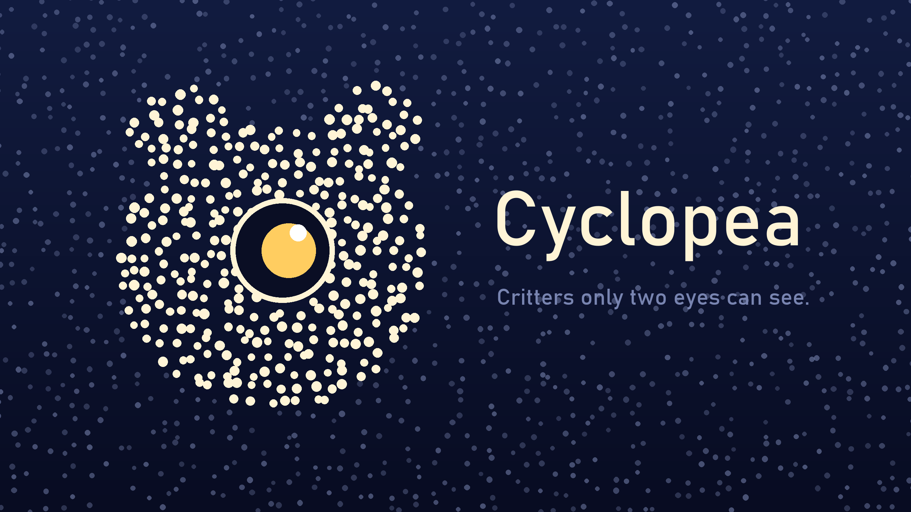
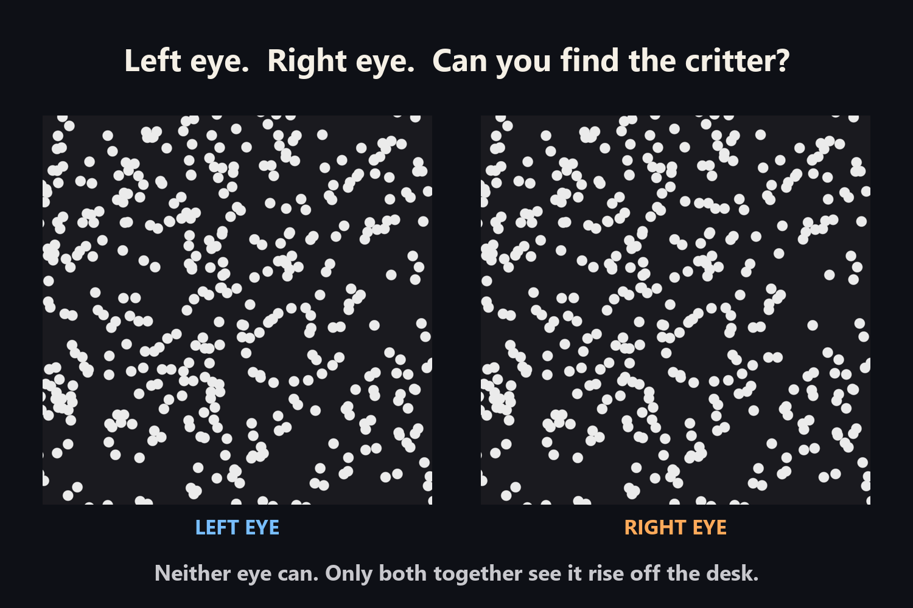
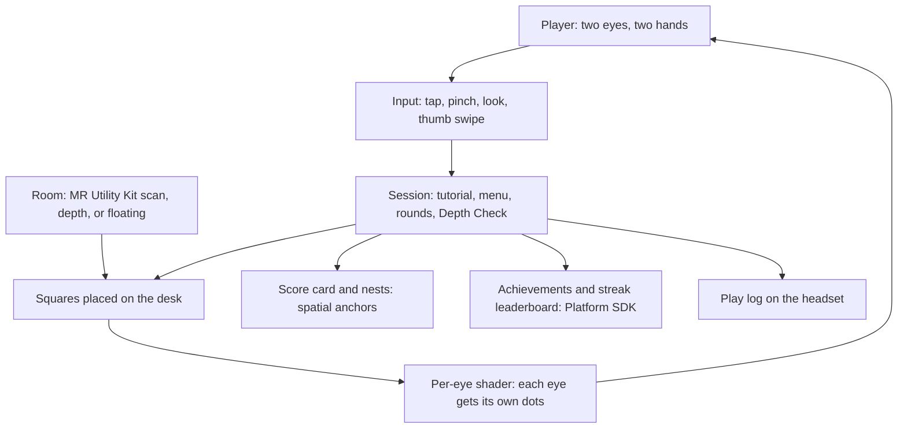

# Cyclopea

**The first game you can't screenshot.** Critters hide in a static of dots on your real desk. Each eye alone sees only noise. When your two eyes compare their images, a critter rises off the desk, and you slap it.

A mixed reality game for Meta Quest 3 and 3S. Seated, hands only, no controllers needed.





## How to try it (for judges)

1. Install the build from the Competition release channel link in the submission (Quest 3 or 3S).
2. Sit at a desk or table with some clear space in front of you. Put the controllers away.
3. Open Cyclopea. Squares of static appear on the desk. Pinch a square, or look at one and hold, to start.
4. Follow the short tutorial: a critter hides in a square and you find it.
5. Play a 60-second round: tap the square where a critter rises. One tap is enough, also when something on the desk stops your finger above the squares.
6. Touch the small **Menu** square at any time for Play, Depth Check, Field guide and Options.

Good to know:

- No room scan? The squares float in front of you instead of sitting on the desk.
- If the squares are out of reach, they come back in front of you between rounds.
- Nothing rises for you? After one round the game switches to motion mode: sway your head gently and one eye is enough.
- To leave, use the Meta button (or the palm menu with hands) and choose Quit.

## What is in the game

- **Critter Whack:** 60-second rounds on a 3×3 grid. Catches in a row build a combo, the last 10 seconds score double, and a golden critter visits each round.
- **It grows with you:** each catch makes the next rise smaller. Your score card shows your finest catch in millimetres.
- **Flat fakes:** some critters are visible to one eye. They are traps.
- **Field guide:** 16 critter kinds to find. They nest in your real room.
- **Score card on your desk:** it stays where you left it, with a 14-day graph.
- **Depth Check:** a short adaptive test that gives a Depth Score with a ± range, or says "not sure this time" instead of guessing.
- **Motion mode:** critters show through head movement, a depth cue that needs only one eye.
- **Ways to choose a square:** tap or slap, point and pinch, look and pinch, thumb swipes, look and hold, or controller triggers.
- **Options:** high contrast, look and hold, less movement, large text, sound level.

## How it works



- **Per-eye shader:** procedural dots drawn once per eye, with sub-pixel shifts between the eyes. The critter is only that shift, so no single image contains it.
- **Input:** Meta Interaction SDK (hand rays, gaze, microgestures) plus our own fingertip tap detection, which reads a tap along the line from the eyes through the fingertip.
- **Room:** MR Utility Kit finds a desk in the room scan. Without a scan, the Depth API finds a surface. Without either, the squares float.
- **Persistence:** spatial anchors keep the score card and the nests in place.

## Built with

Unity 6 (6000.0.85f1, URP, OpenXR) and Meta XR SDK v207: Core, Interaction SDK, MR Utility Kit, Platform SDK, Meta XR Audio.

## Build and test from source

1. Open the project with Unity 6000.0.85f1 (Android build support installed).
2. The scene is built from code in `Assets/Cyclopea/Editor/CyclopeaSetup.cs` and saved at `Assets/Cyclopea/Scenes/Cyclopea.unity`.
3. **Window → General → Test Runner**: run EditMode (86 tests) and PlayMode (61 tests). All pass on version 0.1.5.
4. Build for Android, or use `Tools/quest.sh install` and `Tools/quest.sh run` with a headset on USB.

## What we measured

| What | Result | Where |
|---|---|---|
| Frame rate on Quest 3 | 90 fps in play | the game's own log on the headset |
| One eye alone (rendered per-eye images, 4 choices) | 19–29 % correct, chance is 25 % | `Tools/captures-report.md` |
| Placement in rooms we never saw | 1,372 seats in 87 sample rooms, no bad placement | `Tools/room-sweep.md` |
| Scoring honesty (simulated players with known eyesight) | none of 6,000 without two-eye depth was given a score | `Tools/benchmark.md` |
| Motion mode (rendered) | visible through movement, flat when still | `Tools/motion-report.md` |

The last four are computed from renders and simulations, not from people.

## Research behind it

1. Binocular depth perception of computer-generated patterns. *Bell System Technical Journal*, 1960. https://doi.org/10.1002/j.1538-7305.1960.tb03954.x
   The random-dot idea: a shape that neither eye can see alone.
2. The prevalence and diagnosis of "stereoblindness" in adults less than 60 years of age. *Ophthalmic & Physiological Optics*, 2019. https://doi.org/10.1111/opo.12607
   Why motion mode exists: some adults cannot use two-eye depth.
3. Stereo vision: the haves and have-nots. *i-Perception*, 2015. https://doi.org/10.1177/2041669515593028
   How widely depth vision varies between people.
4. Recovering stereo vision by squashing virtual bugs in a virtual reality environment. *Phil. Trans. R. Soc. B*, 2016. https://doi.org/10.1098/rstb.2015.0264
   Reaching for a target at the depth you see it, as a game action.
5. Applications and implications for extended reality to improve binocular vision and stereopsis. *Journal of Vision*, 2023. https://doi.org/10.1167/jov.23.1.14
   A review that calls for mixed reality in people's own rooms.
6. Randomized trial of a binocular tablet game played at home. *JAMA Ophthalmology*, 2016. https://doi.org/10.1001/jamaophthalmol.2016.4262
   Home play fails when people stop playing, so we built a game people play for fun.
7. Motion parallax as an independent cue for depth perception. *Perception*, 1979. https://doi.org/10.1068/p080125
   The basis of motion mode.

## What is next, and the research it follows

- **A map of everyday depth vision.** With opt-in, anonymous Depth Scores and a university vision lab, show how depth vision varies across far more people than a lab sample [3].
- **Play that lasts at home.** Measure how long people keep playing in their own rooms, the open problem in [5] and [6].
- **Reaching in depth.** Bring back the catch-at-its-height move as a full mode [4].
- **Motion mode as its own game.** More to do with head movement alone [7].
- **Two players, one desk**, and **your desk as camouflage** (the static takes on your desk's colours).
- **Early Access on the Meta Horizon Store, December 2026.**

## Repository layout

```
Assets/Cyclopea/Scripts/Core/      scoring, staircase, depth maths (no Unity types)
Assets/Cyclopea/Scripts/Runtime/   the game: session, round, input, placement, anchors
Assets/Cyclopea/Shaders/           the per-eye random-dot shader and helpers
Assets/Cyclopea/Editor/            builds the scene from code
Assets/Cyclopea/Tests/             EditMode and PlayMode tests
Tools/                             the reports listed above and the scripts that made them
web/                               a small page that explains the idea
```

## Limits

Quest 3 cannot show depth steps finer than about 15 arcseconds, so the game never reports finer.
Cyclopea is a game about depth perception. It is not a medical device and gives no medical advice.
